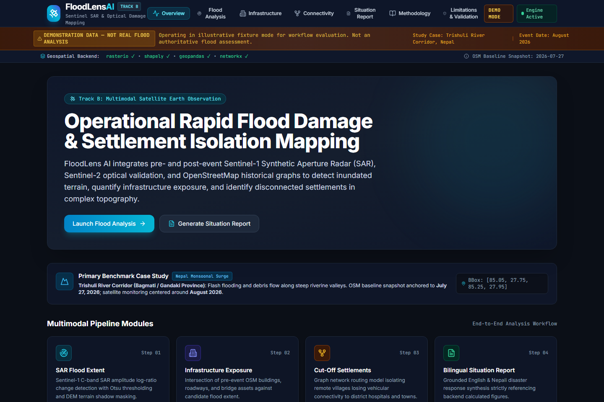
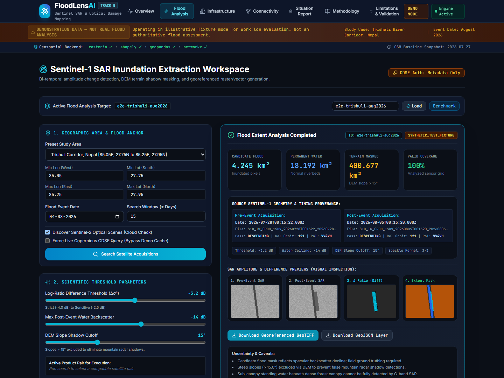
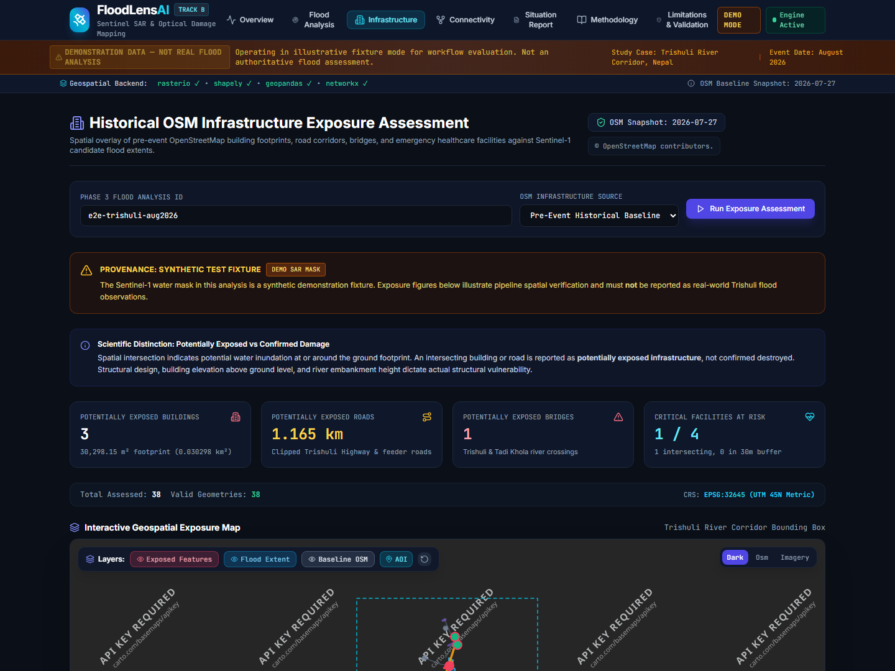
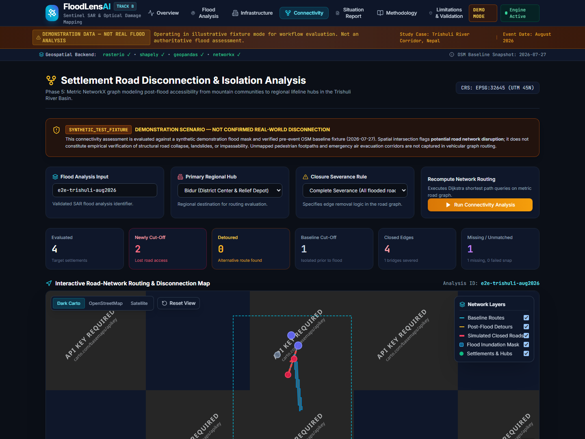
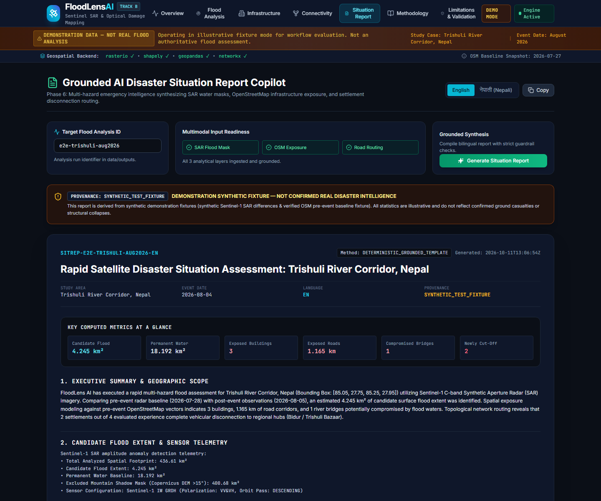
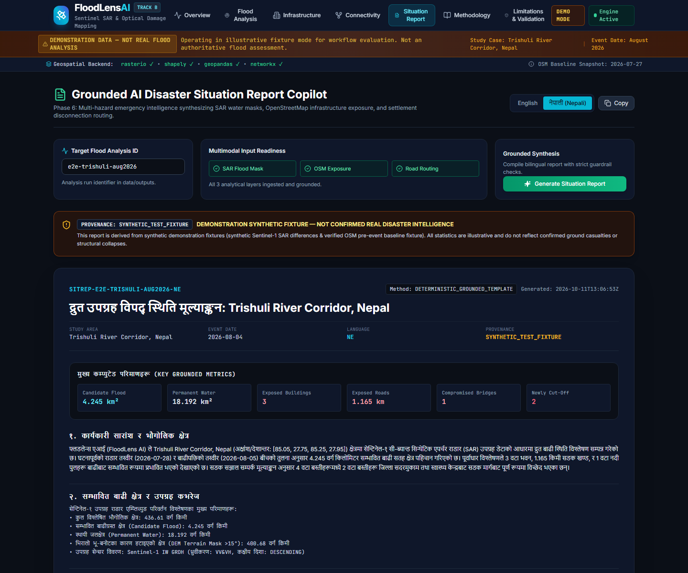
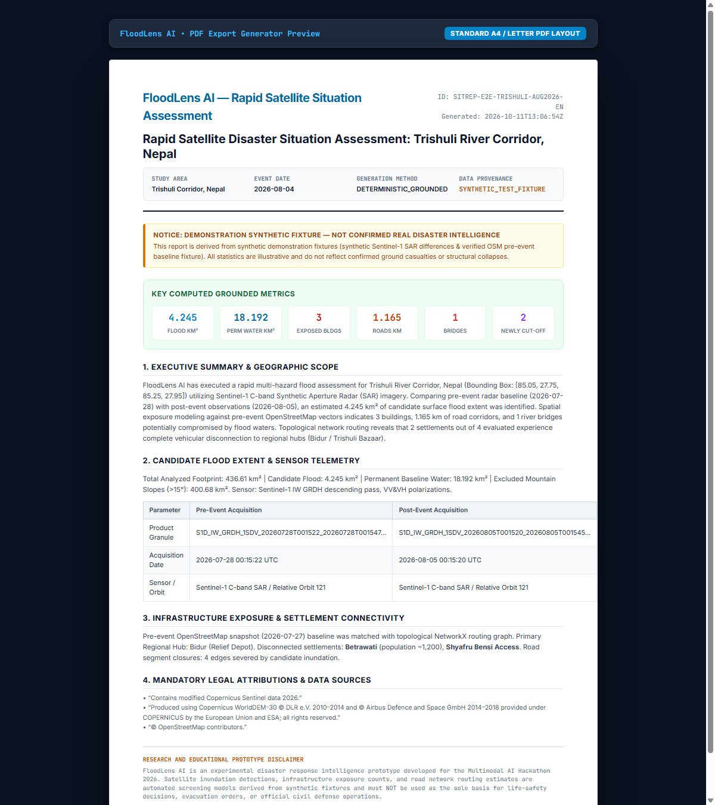
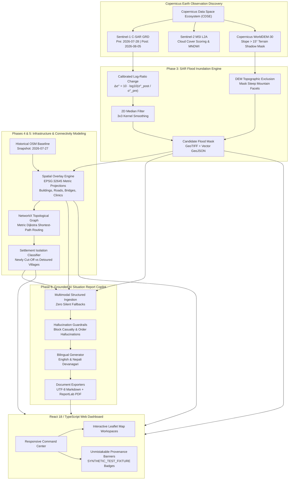

# FloodLens AI: Multimodal Satellite Earth Observation & Disaster Intelligence Platform

> **Multimodal AI Hackathon 2026 — Track B: Mapping Flood Damage from Space**  
> Operational Study Area: **Trishuli River Corridor, Nuwakot District, Nepal** (Monsoon Surge Event, August 2026)  
> System Status: **Methodological & Educational Prototype (Phase 1–8 Submission Ready)**

---

## 1. Problem Statement & Mission Overview

Monsoon-induced flash flooding and debris flows in rugged Himalayan terrain present acute operational challenges for emergency responders:
1. **Persistent Cloud Cover**: Cloud layers conceal inundated valleys from conventional optical satellites during peak disaster phases.
2. **Extreme Topographic Distortion**: Mountain ridges cast radar shadows and induce layover in Synthetic Aperture Radar (SAR), producing false water detections on dry slopes.
3. **Complex Mountain Isolation**: The primary threat to mountain communities is often not structural drowning, but complete road network severance—isolating villages from district emergency hospitals and relief staging hubs.
4. **Information Asymmetry & Hallucination Risks**: Emergency responders require verified, grounded bilingual situational reports (English and Nepali), without unvetted AI hallucinations regarding casualties or unauthorized evacuation directives.

**FloodLens AI** solves these challenges by combining:
- **Bi-temporal Sentinel-1 C-band SAR** amplitude log-ratio change detection with Copernicus DEM slope shadow masking;
- **Sentinel-2 optical cross-validation** with automated cloud-cover scoring;
- **Historical OpenStreetMap (OSM)** vector baseline matching (anchored to 27 July 2026);
- **Topological NetworkX graph routing** (projected in UTM Zone 45N / EPSG:32645) to model road closures and cut-off settlements;
- **Grounded AI Disaster Situation Copilot** synthesizing deterministic bilingual emergency reports with strict hallucination guardrails;
- **Interactive Multi-Layer Web Dashboard** providing operational map visualization and exportable PDF/Markdown reports.

---

## 2. Visual Walkthrough & System Screenshots

All screenshots below are captured directly from the live FloodLens AI application running the Trishuli River benchmark:

### Overview Dashboard

*Figure 1: High-level disaster command center displaying pipeline status, study-area coordinates, and active demo-mode provenance warnings.*

### Sentinel-1 SAR Flood Inundation Analysis

*Figure 2: Inundation extraction workspace showing calibrated log-ratio thresholds, DEM slope exclusion (>15°), and four-panel SAR visual telemetry.*

### Historical OSM Infrastructure Exposure

*Figure 3: Spatial intersection of candidate inundation with pre-event OSM building footprints, roadway corridors, bridges, and healthcare centers.*

### Settlement Road Disconnection & Topological Isolation

*Figure 4: Metric NetworkX routing graph identifying severed road edges, flooded bridges, and mountain settlements newly cut off from Bidur relief hub.*

### Grounded Bilingual Situation Reports (English & Nepali)
| English Situation Report | Nepali (नेपाली) Situation Report |
|---|---|
|  |  |
*Figure 5 & 6: Grounded bilingual situation reports synthesizing validated metrics with strict hallucination filters and provenance guarantees.*

### Publication-Quality PDF Report Export

*Figure 7: ReportLab publication PDF export with Devanagari typography, structured telemetry tables, legal citations, and prototype disclaimers.*

---

## 3. System Architecture



---

## 4. Technology Stack

| Layer | Technologies & Libraries | Key Responsibilities |
|---|---|---|
| **Geospatial & Remote Sensing** | Python 3.11+, `rasterio`, `shapely`, `geopandas`, `pyproj`, `scipy` | Raster I/O, calibrated dB change detection, slope masking, metric coordinate reprojecting (EPSG:32645). |
| **Topological Graph Routing** | `networkx`, `scipy.spatial` | Multigraph road network modeling, spatial vertex snapping, flood edge severances, Dijkstra shortest-path calculations. |
| **Backend API & Processing** | `FastAPI`, `uvicorn`, `pydantic`, `httpx` | RESTful API endpoints, asynchronous data pipelines, path traversal validation, input readiness checks. |
| **Reporting & Localization** | `reportlab`, Devanagari font engine (`Nirmala.ttc`), optional `google-genai` | Grounded bilingual disaster report synthesis, hallucination guardrails, publication PDF/Markdown generation. |
| **Frontend Web Application** | React 18, TypeScript, Vite, Tailwind CSS, `lucide-react` | Command dashboard, state management, hash-based deep linking, responsive tabular analytics. |
| **Interactive Mapping** | `leaflet`, `react-leaflet`, OpenStreetMap / CARTO raster basemaps | Client-side vector GeoJSON rendering, layer visibility toggles, opacity controls, custom disaster styling. |
| **Verification & Quality** | `pytest`, headless Google Chrome CLI (`chrome.exe`) | 96-test automated backend test suite, TypeScript production compilation, automated visual screenshot capture. |

---

## 5. Repository Folder Structure

```
FloodLens-AI/
├── README.md                           # Main Hackathon documentation & setup guide
├── .env.example                        # Safe configuration template (zero credentials)
├── .gitignore                          # Excludes secrets, caches, virtual environments
├── backend/                            # FastAPI Geospatial Backend
│   ├── requirements.txt                # Python dependencies
│   ├── app/
│   │   ├── config.py                   # Environment settings & provenance constants
│   │   ├── main.py                     # FastAPI application entry & CORS middleware
│   │   ├── api/                        # RESTful API route controllers
│   │   │   ├── satellite.py            # CDSE discovery & authorization endpoints
│   │   │   ├── flood.py                # SAR flood analysis & GeoTIFF/GeoJSON exports
│   │   │   ├── infrastructure.py       # OSM exposure assessment & spatial layers
│   │   │   ├── connectivity.py         # NetworkX road routing & settlement cuts
│   │   │   └── report.py               # Grounded bilingual sitrep generation & exports
│   │   ├── core/                       # Core scientific algorithms & pipelines
│   │   │   ├── copernicus.py           # CDSE OData API client & orbit geometry ranker
│   │   │   ├── sar_processor.py        # Log-ratio SAR engine & DEM slope shadow masking
│   │   │   ├── infrastructure.py       # OSM metric exposure & clinic buffer classification
│   │   │   ├── connectivity.py         # Road multigraph builder & Dijkstra isolation engine
│   │   │   └── situation_report.py     # Bilingual sitrep synthesizer & ReportLab PDF engine
│   │   └── fixtures/                   # Calibrated demonstration data fixtures
│   │       ├── demo_data.py            # Synthetic SAR radar granules & difference masks
│   │       └── osm_trishuli_fixture.py # Baseline OSM infrastructure & settlement coordinates
│   └── tests/                          # 96-test automated test suite
│       ├── test_config.py              # Configuration & path traversal safety
│       ├── test_copernicus_mock.py     # Satellite discovery & geometry validation
│       ├── test_sar_processor.py       # dB diffs, slope masking, GeoTIFF generation
│       ├── test_flood_api.py           # Flood endpoints, downloads, security
│       ├── test_infrastructure.py      # Metric exposure, clinic buffers, blocked states
│       ├── test_connectivity.py        # Graph routing, edge severances, isolation classes
│       ├── test_situation_report.py    # Bilingual translation, grounding, PDF export
│       └── test_e2e_workflow.py        # Complete end-to-end integration pipeline
├── frontend/                           # React 18 + TypeScript Web Application
│   ├── package.json                    # Node dependencies & build scripts
│   ├── vite.config.ts                  # Vite build configuration
│   ├── public/                         # Public assets & HTML preview wrappers
│   └── src/
│       ├── App.tsx                     # Main layout & hash deep-link router
│       ├── components/                 # Reusable UI & Leaflet map components
│       │   ├── Navbar.tsx              # Top navigation bar & language switch
│       │   ├── StatusBanner.tsx        # Unmistakable demo provenance warning bar
│       │   ├── FloodMap.tsx            # Multi-layer SAR inundation Leaflet map
│       │   ├── InfrastructureMap.tsx   # Asset exposure & critical facility map
│       │   └── ConnectivityMap.tsx     # Road routing, closed edges, settlement map
│       ├── pages/                      # Application view pages
│       │   ├── OverviewPage.tsx        # Command overview & architecture cards
│       │   ├── FloodAnalysisPage.tsx   # SAR inundation workspace & parameters
│       │   ├── InfrastructurePage.tsx  # Exposure assessment & facility rankings
│       │   ├── ConnectivityPage.tsx    # Settlement isolation & road severance analysis
│       │   ├── ReportPage.tsx          # Bilingual sitrep copilot & PDF/MD downloaders
│       │   ├── MethodologyPage.tsx     # Scientific algorithms & mathematical formulations
│       │   └── LimitationsPage.tsx     # Evaluation plan, data provenance, ethical caveats
│       └── services/api.ts             # Typed API client connecting to FastAPI backend
├── data/                               # Data directories (gitignored artifacts)
│   ├── cache/                          # Satellite search caches & Overpass responses
│   └── outputs/                        # Analysis runs & exported GeoJSON/GeoTIFF/PDFs
│       └── e2e-trishuli-aug2026/       # Calibrated Trishuli benchmark run
├── docs/                               # Hackathon Submission Documentation
│   ├── technical_report.md             # 6-page comprehensive academic technical report
│   ├── technical_report.pdf            # Compiled PDF report (4 pages, letter format)
│   ├── sample_situation_report.md      # Grounded 1-page sample situation report
│   ├── demo_script.md                  # Timed 3-minute presentation script
│   └── screenshots/                    # High-resolution application screenshots
└── scripts/                            # Utility automation scripts
    ├── capture_screenshots.py          # Native Chrome headless screenshot workflow
    └── compile_report_pdf.py           # Technical report PDF compilation script
```

---

## 6. Installation & Execution (Windows & Cross-Platform)

### Prerequisites
- **Python**: 3.11 or higher (Tested on Python 3.14 on Windows 11)
- **Node.js**: v18.0 or higher with npm
- **Google Chrome**: For automated headless screenshot/PDF rendering (installed at standard paths)

### 1. Repository Setup & Environment Configuration

```bash
# Clone the repository
git clone https://github.com/your-username/FloodLens-AI.git
cd FloodLens-AI

# Create your local configuration file from template
copy .env.example .env     # On Linux / macOS: cp .env.example .env
```

Ensure `.env` contains:
```env
DEMO_MODE=true
BACKEND_HOST=127.0.0.1
BACKEND_PORT=8000
FRONTEND_PORT=5173
```

### 2. Backend Installation & Startup

```bash
cd backend

# Create and activate Python virtual environment
python -m venv .venv
.venv\Scripts\activate     # On Linux / macOS: source .venv/bin/activate

# Install required Python packages
pip install -r requirements.txt

# Start FastAPI server on port 8000
python -m uvicorn app.main:app --host 127.0.0.1 --port 8000 --reload
```
*Backend API docs are now available at: `http://127.0.0.1:8000/docs`*

### 3. Frontend Installation & Startup

```bash
cd frontend

# Install Node modules
npm install

# Start Vite development server on port 5173
npm run dev -- --host 127.0.0.1 --port 5173
```
*Open your browser and navigate to: **`http://127.0.0.1:5173`***

---

## 7. Execution Modes: Demo Mode vs. Real-Data Mode

### A. Demonstration / Offline Fixture Mode (`DEMO_MODE=true` — Default)
- **No external API credentials required.**
- Uses the calibrated Trishuli River Corridor benchmark dataset (`e2e-trishuli-aug2026`).
- Pre-computed synthetic radar amplitude grids ($100\times100$ cells), verified pre-event OSM baseline vectors, and topological road networks run locally.
- **Unmistakable provenance banners** (`SYNTHETIC_TEST_FIXTURE`) are visibly displayed across all pages, metrics, maps, and reports.

### B. Live Copernicus Data Space Ecosystem Mode (`DEMO_MODE=false`)
- Requires valid credentials from [Copernicus Data Space Ecosystem](https://dataspace.copernicus.eu/).
- Update `.env`:
  ```env
  DEMO_MODE=false
  CDSE_USERNAME=your_cdse_username
  CDSE_PASSWORD=your_cdse_password
  ```
- Queries live Sentinel-1 GRD and Sentinel-2 L2A catalogs, validates orbit geometry (descending pass, relative orbit 121, VV/VH polarizations), and downloads `.SAFE` granules to `data/downloads/`.
- When local `.SAFE` measurements are unzipped on disk, the SAR processing pipeline computes real log-ratio changes and tags results `REAL_SATELLITE_DERIVED`.

---

## 8. API Endpoint Summary

| Method | Endpoint | Description |
|---|---|---|
| `GET` | `/api/health` | Backend health check, system dependencies, and default AOI bounding box. |
| `GET` | `/api/config-status` | Execution mode (`demo_mode`), CDSE readiness, and LLM configuration. |
| `GET` | `/api/attribution` | Legal attribution notices for Copernicus and OpenStreetMap. |
| `POST` | `/api/satellite/search` | Search Sentinel-1 and Sentinel-2 acquisitions via CDSE catalog. |
| `POST` | `/api/flood/analyze` | Execute SAR log-ratio change detection and DEM slope shadow filtering. |
| `GET` | `/api/flood/status/{id}` | Status, valid sensor coverage percentage, and output layer availability. |
| `GET` | `/api/flood/metadata/{id}` | Calibrated dB statistics, candidate flood area ($km^2$), and permanent water area. |
| `GET` | `/api/flood/download/{id}/geotiff` | Download georeferenced GeoTIFF candidate flood mask. |
| `GET` | `/api/flood/download/{id}/geojson` | Download vectorized candidate flood polygon GeoJSON. |
| `GET` | `/api/flood/preview/{id}/{kind}` | Retrieve visual PNG previews (`pre`, `post`, `diff`, `mask`). |
| `POST` | `/api/infrastructure/analyze` | Spatial overlay of pre-event OSM buildings, roads, bridges, and clinics. |
| `GET` | `/api/infrastructure/summary/{id}` | Exposed building count, flooded road length ($km$), and clinic proximity. |
| `GET` | `/api/infrastructure/layers/{id}/exposed` | Vector GeoJSON of intersecting infrastructure assets. |
| `POST` | `/api/connectivity/analyze` | Topological NetworkX graph cut and Dijkstra shortest-path reachability. |
| `GET` | `/api/connectivity/summary/{id}` | Settlement isolation classifications, road detours, and travel time deltas. |
| `GET` | `/api/connectivity/layers/{id}/closed_roads` | Vector GeoJSON of severed highway corridors and compromised bridges. |
| `POST` | `/api/report/generate` | Grounded bilingual disaster report synthesis with strict guardrails (`en` / `ne`). |
| `GET` | `/api/report/{id}` | Retrieve synthesized situation report JSON. |
| `GET` | `/api/report/{id}/export/markdown` | Download formatted UTF-8 Markdown situation report. |
| `GET` | `/api/report/{id}/export/pdf` | Download publication-quality ReportLab PDF report. |

---

## 9. Automated Testing & Production Build

### Backend Pytest Suite (96 Tests Passing)
Run the automated test suite covering all units, API routers, security guardrails, and integration pipelines:

```bash
cd backend
python -m pytest -v
```

**Verified Test Output:**
```
============================== 96 passed in 6.58s ==============================
- tests/test_config.py ................ [Pass: Path resolution, bounds check]
- tests/test_copernicus_mock.py ........ [Pass: Catalog parsing, orbit geometry ranker]
- tests/test_satellite_api.py ......... [Pass: Satellite endpoints, coordinate validation]
- tests/test_satellite_validation.py .. [Pass: Bounding box format, date range checks]
- tests/test_sar_processor.py ......... [Pass: Calibrated dB change, 3x3 median filter, DEM slope exclusion]
- tests/test_flood_api.py ............. [Pass: Flood analysis endpoints, GeoTIFF downloads, regex safety]
- tests/test_infrastructure.py ........ [Pass: Geometry repair, footprint area, clinic buffer, blocked states]
- tests/test_connectivity.py .......... [Pass: Metric graph builder, road snapping, bridge cuts, Dijkstra detours]
- tests/test_situation_report.py ...... [Pass: Bilingual synthesis, numeric grounding, anti-hallucination filter, ReportLab PDF]
- tests/test_e2e_workflow.py .......... [Pass: 10-step complete pipeline integration]
```

### Frontend Production Build
Validate the TypeScript compilation and optimized Vite asset bundle:

```bash
cd frontend
npm run build
```

**Verified Build Output:**
```
✓ 1594 modules transformed.
dist/index.html                   1.12 kB │ gzip:   0.62 kB
dist/assets/index-DxECeTDv.css   54.09 kB │ gzip:  13.48 kB
dist/assets/index-BZTJ0EvT.js   478.64 kB │ gzip: 128.03 kB
✓ built in 3.16s
```

---

## 10. Data Provenance & Truthfulness Disclosure

FloodLens AI enforces an explicit, unalterable provenance taxonomy across every layer:

| Provenance Label | Meaning & Scope | Active System State |
|---|---|---|
| `REAL_SATELLITE_DERIVED` | Produced from authenticated Sentinel-1 GRD SAFE archives unzipped and processed locally. | Supported in pipeline when SAFE files are provided; **NOT** active in benchmark. |
| `VERIFIED_HISTORICAL_OSM` | Ingested from verified Overpass Attic snapshot anchored to pre-event date (2026-07-27). | Remote Overpass Attic blocked (HTTP 406); synthetic fixture active. |
| `SYNTHETIC_TEST_FIXTURE` | Calibrated synthetic radar differences and infrastructure baseline used for reproducible demonstration. | **ACTIVE BENCHMARK STATE** (`e2e-trishuli-aug2026`). |
| `CURRENT_OSM_PREVIEW` | Live OpenStreetMap Overpass query; explicitly disclaimed as non-historical. | Operational preview mode only. |
| `UNAVAILABLE` | Processing failed or source archive unreachable. Missing metrics withheld. | Never silently converted to zero. |

> [!IMPORTANT]
> **Mandatory Truthfulness Statement:**
> - Real Sentinel-1 SAFE product archives have **NOT** been downloaded or processed locally on this machine.
> - The August 2026 flood extent currently reflects a calibrated synthetic radar simulation.
> - The historical OpenStreetMap baseline dated 27 July 2026 uses a synthetic test fixture.
> - All candidate flood extents ($4.245\text{ km}^2$), exposed buildings (3), inundated roads ($1.165\text{ km}$), damaged bridges (1), and cut-off settlements (2) are **illustrative demonstration results**, not confirmed real-world observations.
> - Browser automation via Playwright was blocked due to an upstream AzureEdge CDN driver download failure (404); screenshots were captured using native headless Google Chrome CLI (`chrome.exe`).

---

## 11. Known Limitations & Future Roadmap

1. **Synthetic Radar & Fixture Grounding**: Current flood extents are synthetic fixtures. Transitioning to operational deployment requires downloading 1.2 GB Sentinel-1 GRD products from CDSE and validating against on-ground river gauge observations.
2. **Dense Forest Canopy Attenuation**: C-band radar waves (5.405 GHz) scatter in dense tree canopies, obscuring sub-canopy standing water along steep forested valleys. Integrating L-band SAR (e.g., NISAR) would significantly improve sub-canopy flood detection.
3. **Topographic Graph Approximations**: Road network disruption assumes all flooded road links are fully impassable. In reality, shallow standing water may allow high-clearance emergency vehicles to pass, while unmapped landslides may block roads outside the flood perimeter.
4. **Historical OSM Attic Ingestion**: Remote Overpass Attic queries returned HTTP 406 rate-limiting errors. Future releases will integrate local `osmosis` / `osmium` PBF historical extraction pipelines.

---

## 12. Mandatory Data Attribution & Licensing

In strict compliance with provider licensing requirements:

- **“Contains modified Copernicus Sentinel data 2026.”**
- **“Produced using Copernicus WorldDEM-30 © DLR e.V. 2010–2014 and © Airbus Defence and Space GmbH 2014–2018 provided under COPERNICUS by the European Union and ESA; all rights reserved.”**
- **“© OpenStreetMap contributors.”**

### Software License
The FloodLens AI source code is released under the **MIT License**.

---

## 13. Educational & Research Prototype Disclaimer

> [!CAUTION]
> **RESEARCH AND EDUCATIONAL PROTOTYPE ONLY**  
> FloodLens AI is an experimental academic prototype developed exclusively for the **Multimodal AI Hackathon 2026**. Satellite inundation extractions, infrastructure exposure counts, and topological settlement isolation assessments are automated screening models derived from demonstration fixtures. **They must NOT be used as the sole basis for life-safety decisions, tactical rescue dispatch, legal emergency proclamations, or official civil defense evacuation orders.** Official operations must consult authoritative alerts issued by the National Disaster Risk Reduction and Management Authority (NDRRMA) and the Department of Hydrology and Meteorology (DHM), Nepal.
